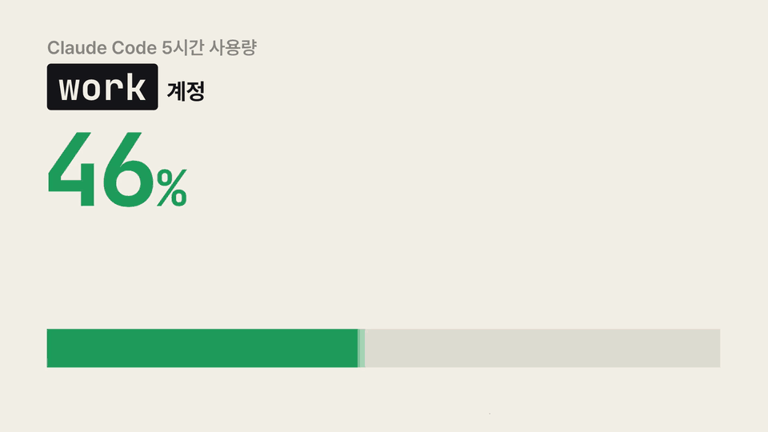

# ccm

[English](README.md) · **한국어**

Claude Code 계정을 여러 개 쓸 때, 계정마다 남은 사용량을 한 화면에서 보고 여유 있는 계정으로 바로 바꿔 주는 명령줄 도구입니다.

<p align="center">
  
</p>

<p align="center"><a href="docs/media/ccm-intro-ko.mp4">소리가 있는 영상(MP4, 15초)</a></p>

## 이런 때 씁니다

- Claude Code를 쓰다가 사용량 한도에 걸려 작업이 멈췄습니다.
- 계정이 여러 개인데, 어느 계정에 여유가 있는지 하나씩 로그인해 봐야 압니다.
- 다른 계정으로 바꾸면 하던 대화를 처음부터 다시 설명해야 합니다.

ccm은 이 세 가지를 해결합니다.

1. **계정마다 남은 사용량을 표로 보여 줍니다.** 5시간·주간 사용률과 다시 쓸 수 있게 되는 시각을 계정별로 한 번에 봅니다.
2. **로그아웃 없이 계정을 바꿉니다.** 계정마다 미리 로그인해 두고, 표에서 방향키로 골라 그 계정으로 `claude`를 실행합니다.
3. **하던 대화를 그대로 이어 갑니다.** 계정을 바꿔도 대화 기록·설정·스킬을 함께 씁니다. 한도에 걸리면 `ccm next -c` 한 줄로 여유가 가장 많은 계정에서 마지막 대화를 이어 엽니다.

ccm은 로그인 토큰을 읽거나 옮기지 않습니다. 로그인은 Claude Code의 `claude auth login`이 처리하고, ccm은 계정마다 설정 폴더를 따로 지정해 줄 뿐입니다.

## 설치

### 준비물

| 필요한 것 | 확인하는 명령 |
| --- | --- |
| macOS(확인함) 또는 Linux(확인하지 않음). Windows는 지원하지 않습니다 | |
| Python 3.8 이상 | `python3 --version` |
| Claude Code 설치와 로그인 | `claude --version` |
| zsh 또는 bash | `echo $SHELL` |

Claude Code가 없으면 [공식 설치 안내](https://docs.anthropic.com/en/docs/claude-code/setup)를 따라 설치하고 한 번 로그인합니다. ccm은 Python 표준 라이브러리만 쓰므로 따로 설치할 패키지는 없습니다.

### 1단계. 내려받기

계속 둘 폴더에 내려받습니다. 나중에 폴더를 옮기면 다시 연결해야 하므로(아래 "자주 묻는 질문" 참고) 자리를 먼저 정하는 편이 좋습니다.

```sh
git clone https://github.com/revfactory/ccm.git ~/ccm
cd ~/ccm
```

### 2단계. `ccm` 명령 설치

```sh
./install.sh
```

`~/.local/bin/ccm`에 링크를 만듭니다. "주의: … PATH에 없습니다"라는 안내가 나오면 셸 설정 파일에 경로를 추가합니다.

```sh
echo 'export PATH="$HOME/.local/bin:$PATH"' >> ~/.zshrc   # bash면 ~/.bashrc
source ~/.zshrc
```

### 3단계. 상태줄과 셸 함수 연결

```sh
ccm setup
source ~/.zshrc   # bash면 source ~/.bashrc, 또는 새 터미널 열기
```

두 가지를 설정합니다.

- **상태줄**: Claude Code 화면 아래 상태줄이 계정별 사용률을 기록합니다. 원래 쓰던 상태줄이 있으면 그대로 보이고, 뒤에 `[work] 5h 72% ↻16:26 · 7d 31%`처럼 붙습니다.
- **셸 함수**: 그냥 `claude`라고 입력해도 ccm에서 고른 계정으로 실행되게 합니다.

`~/.claude/settings.json`을 고치기 전에 같은 폴더에 백업(`settings.json.ccm-backup-<시각>`)을 만듭니다. 되돌리려면 `ccm setup --undo`를 실행합니다.

### 4단계. 계정 추가

지금까지 쓰던 계정은 `default`라는 이름으로 이미 들어 있습니다. 다른 계정은 이름을 붙여 추가합니다.

```sh
ccm add work
ccm add side --email side@example.com   # 로그인 화면에 이메일을 미리 넣을 때
```

브라우저가 열리면 그 이름으로 쓸 계정으로 로그인합니다. 끝나면 어느 이메일로 로그인했는지 보여 줍니다.

- 브라우저에 다른 계정이 이미 로그인되어 있으면 그 계정이 그대로 승인될 수 있습니다. 이때는 브라우저에서 로그아웃하거나, 터미널에 나온 로그인 주소를 시크릿 창에서 엽니다.
- 이미 등록한 계정과 같은 계정으로 로그인하면 경고가 나옵니다.
- `default` 계정에 등록한 MCP 서버와 이미 신뢰한 폴더 목록을 새 계정에 복사합니다. 그래서 새 계정으로 처음 실행해도 폴더 신뢰 확인을 다시 묻지 않습니다. 복사하지 않으려면 `--no-sync`를 붙입니다.

### 5단계. 계정마다 한 번씩 실행하기

사용량은 각 계정으로 Claude Code를 쓸 때 상태줄이 기록합니다. 추가한 계정마다 한 번 실행해 질문을 하나 보내고 응답을 받은 뒤 종료합니다.

```sh
ccm run work
```

처음 실행하면 Claude Code가 테마 선택을 다시 물어볼 수 있습니다.

### 6단계. 점검

```sh
ccm doctor
```

모든 줄이 `✓`이면 설치가 끝난 것입니다. `!` 줄은 안내대로 고칩니다. 링크가 빠진 경우는 `ccm doctor --fix`가 고칩니다.

## 사용법

### 표를 보고 계정 고르기: `ccm`

```text
$ ccm
Claude Code 계정 · 현재 default · 15:27 기준
      #  이름     계정                요금제  5시간 사용                 주간 사용                   기록
   ●  1  default  me@gmail.com        Max     ████████ 100% 한도 ↻16:57  █████░░░  64% ↻10/30 15:57  2분 전
      2  work     me@company.example  Max     ███░░░░░  38% ↻17:40       ███░░░░░  41% ↻10/29 15:27  3시간 전
❯     3  side     side@example.org    Pro     █░░░░░░░  12% ↻18:47       █░░░░░░░   9% ↻10/31 15:27  1일 전
사용량은 각 계정으로 Claude Code를 쓸 때 상태줄이 받은 마지막 값이며, 초기화 시각이 지난 창은 0%로 표시합니다.
여유가 가장 많은 다른 계정: 3 side (5시간 12% · 주간 9%)
↑↓ 이동 · Enter 실행 · ESC 종료
```

| 키 | 동작 |
| --- | --- |
| ↑ ↓ (또는 k j) | 커서 이동. 맨 아래에서 ↓를 누르면 맨 위로 갑니다 |
| 1\~9 | 그 번호의 계정으로 커서 이동 |
| Enter | 커서가 있는 계정으로 바꾸고 `claude` 실행 |
| ESC (또는 q) | 종료할지 묻습니다. y나 Enter를 누르면 종료하고, n이나 ESC를 누르면 표로 돌아갑니다 |
| Ctrl+C | 묻지 않고 바로 종료 |

### 한도에 걸렸을 때: `ccm next -c`

1. 한도에 걸린 Claude Code 세션을 `/exit`로 종료합니다.
2. 아래 명령을 실행합니다.

```sh
ccm next -c
```

현재 계정을 뺀 계정 가운데 여유가 가장 많은 계정으로 바꾸고, 같은 프로젝트의 마지막 대화를 이어서 엽니다. `-c`는 `claude`에 그대로 넘기는 옵션(이전 대화 이어 가기)입니다. 고르는 기준은 아래 "여유가 많은 계정을 고르는 기준"에 있습니다.

이미 실행 중인 세션은 계정이 바뀌지 않습니다. 계정을 바꾼 뒤 새로 실행하는 `claude`부터 바뀐 계정을 씁니다.

### 자주 쓰는 명령

| 하려는 일 | 명령 |
| --- | --- |
| 표를 보고 골라서 실행 | `ccm` |
| 표에서 골라 이전 대화 이어서 실행 | `ccm -- -c` |
| 여유가 가장 많은 다른 계정으로 바꾸고 이전 대화 이어서 실행 | `ccm next -c` |
| 계정만 바꾸기 (이후 `claude`에 적용) | `ccm use work` 또는 `ccm use 2`, 표에서 고르려면 `ccm -n` |
| 현재 계정은 두고 다른 계정으로 한 번만 실행 | `ccm run side -c` |
| 표만 보기 / JSON으로 보기 | `ccm ls`, `ccm ls --json` |
| 계정 추가 / 다시 로그인 / 삭제 | `ccm add work`, `ccm login work`, `ccm rm side` |
| default의 MCP 서버와 신뢰한 폴더를 다른 계정에 복사 | `ccm sync` (미리 보기 `ccm sync --dry-run`) |
| 설정 점검과 복구 | `ccm doctor`, `ccm doctor --fix` |
| 출력 언어 보기·바꾸기 | `ccm lang`, `ccm lang ko` |

계정은 이름, 번호, 이름 앞부분, 이메일 일부 가운데 무엇으로든 지정할 수 있습니다.

### 출력 언어

ccm은 한국어와 영어로 출력합니다. 아래 순서로 언어를 정합니다.

1. 환경변수 `CCM_LANG`(`ko` 또는 `en`)
2. `ccm lang ko` 또는 `ccm lang en`으로 저장한 값
3. `LC_ALL`, `LC_MESSAGES`, `LANG` 가운데 하나가 `ko`로 시작하면 한국어
4. macOS 시스템 언어의 첫 번째가 한국어면 한국어
5. 그 밖에는 영어

macOS는 시스템 언어가 한국어여도 터미널의 `LANG`이 `en_US.UTF-8`인 경우가 많아서 4번을 함께 봅니다. `ccm lang`을 실행하면 지금 언어와 그렇게 정한 근거를 보여 주고, `ccm lang auto`는 저장한 값을 지웁니다.

## 화면 읽는 법

| 표시 | 뜻 |
| --- | --- |
| `●` | 현재 계정. 셸 함수가 `claude`를 이 계정으로 실행합니다 |
| `❯`와 반전색 행 | 커서 위치 |
| 막대 색 | 초록은 70% 미만, 노랑은 70\~89%, 빨강은 90% 이상 |
| `한도` | 사용률이 100%에 도달한 창 |
| `↻16:57` | 그 창이 초기화되는 시각. 날짜가 다르면 `↻10/30 15:57`처럼 날짜를 붙입니다 |
| `초기화됨` | 초기화 시각이 지난 창. 0%로 표시합니다 |
| `기록 없음` | 그 계정으로 아직 Claude Code를 쓰지 않아 값이 없습니다 |
| 기록 열 | 사용량을 마지막으로 기록한 때 |
| 여유가 가장 많은 다른 계정 | `ccm next`가 고를 계정. 앞의 숫자를 누르면 커서가 그 계정으로 갑니다 |

표의 값은 **각 계정으로 Claude Code를 마지막으로 썼을 때** 받은 값입니다. 그 뒤에 claude.ai 웹이나 다른 컴퓨터에서 쓴 양은 다음에 그 계정으로 Claude Code를 쓸 때 반영됩니다.

### 여유가 많은 계정을 고르는 기준

- 5시간·주간 두 창 가운데 사용률이 높은 쪽, 곧 먼저 한도에 닿을 창의 사용률을 비교해 더 낮은 계정을 고릅니다. 같으면 5시간 사용률이 낮은 계정을 고릅니다. 기록이 없는 창은 0%로 봅니다.
- 로그인되지 않은 계정, API 키처럼 다른 방식으로 인증한 계정, 현재 계정과 같은 이메일로 로그인한 계정은 후보에서 뺍니다.
- 다른 계정이 모두 한도에 도달했으면 바꾸지 않고, 가장 먼저 풀리는 계정과 초기화 시각을 알려 줍니다.

## 자주 묻는 질문

**표에 `기록 없음`만 나옵니다.**
그 계정으로 Claude Code를 실행해 응답을 한 번 받아야 기록됩니다(`ccm run <이름>`). 계속 기록되지 않으면 `ccm doctor`로 상태줄 연결을 확인합니다.

**`ccm: command not found`가 나오거나 Claude Code 상태줄이 비었습니다.**
ccm 폴더를 옮기거나 이름을 바꾸면 `~/.local/bin/ccm` 링크가 가리키는 파일이 없어집니다. 이때 Claude Code는 오류를 보여 주지 않고 상태줄을 비워 두며, 사용량 기록도 멈춥니다. 새 위치에서 아래 명령을 실행합니다.

```sh
./install.sh          # 링크를 새 위치로 다시 만듦
./ccm doctor --fix    # 링크와 상태줄 명령 경로를 점검하고 고침
```

**계정을 추가했는데 다른 계정으로 로그인됐습니다.**
브라우저에 이미 로그인된 계정이 승인된 경우입니다. 브라우저에서 로그아웃하거나 시크릿 창을 연 뒤 `ccm login <이름>`으로 다시 로그인합니다.

**`ANTHROPIC_API_KEY` 환경변수가 남아 있다는 경고가 나옵니다.**
이 변수가 있으면 Claude Code는 로그인한 계정 대신 API 키를 씁니다. 셸 설정 파일에서 지운 뒤 새 터미널을 열거나 `unset ANTHROPIC_API_KEY`를 실행합니다. Claude Code 세션 안에서 `!ccm`으로 실행하면 그 세션이 물려받은 값 때문에 경고가 계속 나올 수 있으니, 새 터미널에서 확인합니다.

**새 계정에서 MCP 서버를 다시 등록해야 하나요?**
`ccm add`가 default 계정의 MCP 서버를 복사합니다. 나중에 default에 서버를 추가했다면 `ccm sync`를 실행합니다. 저장소의 `.mcp.json`에 넣은 프로젝트 범위 서버는 복사하지 않아도 모든 계정에서 쓰입니다.

**Team 요금제 계정도 사용량이 나오나요?**
Team 요금제 계정에서 기록되는 것을 확인했습니다. Enterprise 계정은 확인하지 않았습니다.

**ccm을 지우려면 어떻게 하나요?**

```sh
ccm rm <이름>          # 추가한 계정마다 실행 (키체인의 로그인 정보도 삭제)
ccm setup --undo       # 상태줄 설정과 셸 함수를 설치 전으로
rm ~/.local/bin/ccm
rm -rf ~/.ccm
```

## 동작 방식

- **계정마다 설정 폴더를 따로 둡니다.** Claude Code 문서가 안내하는 다중 계정 방식(`CLAUDE_CONFIG_DIR`)을 씁니다. 원래 쓰던 `~/.claude`는 `default` 계정이고, 추가한 계정은 `~/.ccm/profiles/<이름>/`을 씁니다.
- **로그인은 Claude Code가 처리합니다.** `ccm add`가 그 폴더를 지정해 `claude auth login`을 실행합니다. 로그인 정보는 Claude Code가 폴더별로 키체인에 저장합니다.
- **사용량은 상태줄이 기록합니다.** Claude Code는 상태줄 명령에 `rate_limits`(5시간·주간 사용률과 초기화 시각)를 넘겨줍니다. ccm은 이 값을 `~/.ccm/usage/<이름>.json`에 저장합니다.
- **설정과 작업 기록은 계정끼리 공유합니다.** 추가한 계정 폴더에서 `~/.claude`의 설정·스킬·플러그인·세션 기록·작업 목록으로 심볼릭 링크를 겁니다. 그래서 같은 프로젝트에서는 계정을 바꿔도 이전 작업을 그대로 이어 갑니다.

<details>
<summary><b>계정을 바꿔도 이어지는 작업</b></summary>

모든 계정의 세션이 `~/.claude` 아래 같은 폴더에 기록됩니다. 그래서 같은 프로젝트 폴더에서는 어느 계정으로 실행해도 다음 기록을 함께 씁니다.

| 하려는 일 | 공유되는 기록 |
| --- | --- |
| 마지막 대화를 다른 계정으로 이어서 하기 (`claude -c`, `ccm next -c`) | `projects`의 세션 기록 |
| 이전 세션을 골라 다시 열기 (`/resume`, `claude --resume`) | 모든 계정의 세션이 한 목록에 나옵니다 |
| 이어 간 세션의 작업 목록 보기 | `tasks`, `todos`, `plans` |
| 새 세션에서도 프로젝트 내용 기억하기 | `projects/<프로젝트>/memory`의 자동 메모리, `CLAUDE.md` |
| 이전에 입력한 프롬프트를 ↑로 다시 불러오기 | `history.jsonl`, `paste-cache` |
| 파일 변경 되돌리기 (`/rewind`) | `file-history` |
| 다른 계정으로 실행 중인 세션 찾기와 메시지 주고받기 | `sessions`, `teams` |

`claude -c`가 다른 계정 폴더에서도 같은 세션에 이어 붙는 것은 실제 `claude`로 확인했습니다. 세션 기록을 공유하지 않으려면 계정을 추가할 때 `--no-share-history`를 붙입니다.

</details>

<details>
<summary><b>공유하는 항목과 공유하지 않는 항목</b></summary>

새 계정 폴더에는 아래 항목을 `~/.claude`로 링크합니다.

- 설정: `settings.json`, `CLAUDE.md`, `agents`, `commands`, `skills`, `plugins`, `output-styles`, `hooks`, `memory`, `keybindings.json`, `loop.md` (`~/.claude`에 있는 것만), `rules`, `workflows`, `themes`, `agent-memory`
- 작업 기록: `projects`, `history.jsonl`, `file-history`, `todos`, `plans`, `tasks`, `teams`, `paste-cache`, `session-env`, `sessions`

작업 기록 폴더와 `rules`, `workflows`, `themes`, `agent-memory` 폴더는 `~/.claude`에 아직 없으면 먼저 만들고 링크합니다. 링크가 없는 상태에서 Claude Code가 그 폴더를 쓰면 계정 폴더 안에 따로 만들어 기록이 계정별로 나뉘기 때문입니다. 예를 들어 사용자 범위 메모리를 쓰는 서브에이전트는 `agent-memory`에 기록을 남기는데, 링크가 없으면 계정마다 메모리가 달라집니다.

`ccm`, `ccm ls`, `ccm use`, `ccm run`, `ccm next`를 실행할 때마다 링크를 점검합니다. 빠진 링크는 새로 만듭니다. 계정 폴더 안에 따로 생긴 기록 폴더가 있으면 내용을 `~/.claude` 쪽으로 옮긴 뒤 링크로 바꿉니다. 이름이 겹치는 폴더는 안쪽 내용을 합칩니다. 이름이 겹치는 파일은 `note.json.work`처럼 계정 이름을 붙여 옮기고, 어떤 파일도 지우지 않습니다(`.DS_Store` 제외). 옮긴 내용은 실행할 때 한 줄로 알려 줍니다.

계정마다 따로 두는 것은 아래와 같습니다.

- **로그인 정보**: 계정을 나누는 목적이므로 공유하지 않습니다.
- **`.claude.json`**: 사용자 범위·로컬 범위 MCP 서버 목록, 폴더 신뢰 여부, 첫 실행 설정이 들어 있습니다. 로그인한 계정 정보도 같은 파일에 있어서 링크로 공유할 수 없습니다. 대신 `ccm sync`가 MCP 서버와 폴더 신뢰 여부를 복사합니다.
- **`jobs`, `daemon`**: 계정마다 따로 실행되는 백그라운드 작업입니다. 공유하면 같은 작업이 두 번 실행될 수 있어서 나눠 둡니다.

Claude Code가 설정 파일을 저장하면서 링크를 일반 파일로 바꾸면 그 항목은 더 이상 공유되지 않습니다. `ccm doctor`가 이런 항목을 찾아 알려 줍니다.

</details>

<details>
<summary><b>MCP 서버와 폴더 신뢰 설정 복사 (<code>ccm sync</code>)</b></summary>

`ccm sync`는 한 계정의 `.claude.json`에서 아래 설정을 읽어 다른 계정의 `.claude.json`에 합칩니다. default 계정의 파일은 `~/.claude.json`, 추가한 계정의 파일은 `~/.ccm/profiles/<이름>/.claude.json`입니다.

- 사용자 범위 MCP 서버 (`claude mcp add -s user`로 등록한 서버)
- 프로젝트별 로컬 범위 MCP 서버 (`claude mcp add`로 그 폴더에서 등록한 서버)
- 폴더 신뢰 여부 (신뢰 확인 창에서 허용한 폴더)

| 하려는 일 | 명령 |
| --- | --- |
| default의 설정을 나머지 모든 계정에 복사 | `ccm sync` |
| 특정 계정에만 복사 | `ccm sync work side` |
| 다른 계정의 설정을 가져와 복사 | `ccm sync --from work` |
| 바꿀 내용만 미리 보기 | `ccm sync --dry-run` |
| 이름이 같고 설정이 다른 MCP 서버도 덮어쓰기 | `ccm sync --replace` |

받는 계정에 없는 항목만 추가하고, 지우는 항목은 없습니다. 이름이 같은데 설정이 다른 MCP 서버는 그대로 두고 이름을 알려 줍니다. Claude Code가 이 파일을 고칠 때 쓰는 잠금(`.claude.json.lock` 폴더)을 똑같이 잡고 고치므로, 그 계정으로 실행 중인 세션이 있어도 서로의 변경을 덮어쓰지 않습니다. 다만 실행 중인 세션에는 다시 시작해야 반영됩니다.

</details>

<details>
<summary><b>사용량 기록의 세부 동작</b></summary>

- 같은 계정으로 세션을 여러 개 띄우면, 쉬고 있던 세션도 프롬프트 캐시가 만료되거나 창이 초기화될 때 자기가 마지막으로 받은 값으로 상태줄을 다시 그립니다. ccm은 이런 예전 값으로 기록을 바꾸지 않습니다. 초기화 시각이 같은 창이면 더 높은 사용률만 기록하고, 이미 끝난 창의 값은 버립니다.
- 같은 이메일·조직으로 로그인한 프로필이 여럿이면 한도를 함께 쓰므로, 표에는 그중 가장 최근 기록을 함께 보여 줍니다.
- 환경변수는 프로세스가 시작될 때 정해집니다. 셸 설정 파일에서 변수를 지워도 이미 열려 있는 터미널과 실행 중인 Claude Code 세션에는 값이 남아 있습니다.
- `ccm`과 `ccm doctor`는 상태줄 명령에 적힌 Python과 ccm 파일이 실제로 있는지 확인하고, 없으면 경고합니다.

</details>

## 파일 위치

| 경로 | 내용 |
| --- | --- |
| `~/.ccm/config.json` | 계정 목록, 현재 계정, 마지막으로 확인한 이메일·요금제 |
| `~/.ccm/current-dir` | 셸 함수가 읽는 현재 계정 폴더 경로 (default면 빈 파일) |
| `~/.ccm/profiles/<이름>/` | 추가한 계정의 Claude Code 설정 폴더 |
| `~/.ccm/usage/<이름>.json` | 상태줄이 기록한 계정별 사용률 |
| `~/.ccm/statusline-prev.json` | `ccm setup` 전에 쓰던 상태줄 설정 (`--undo`가 복원) |

## 테스트

```sh
python3 -m unittest tests.test_ccm -v
```

테스트는 가짜 `claude`(`tests/fake_claude.py`)와 `_workspace/tmp/` 아래 임시 폴더만 쓰고, 실제 키체인과 `~/.claude`는 건드리지 않습니다.
