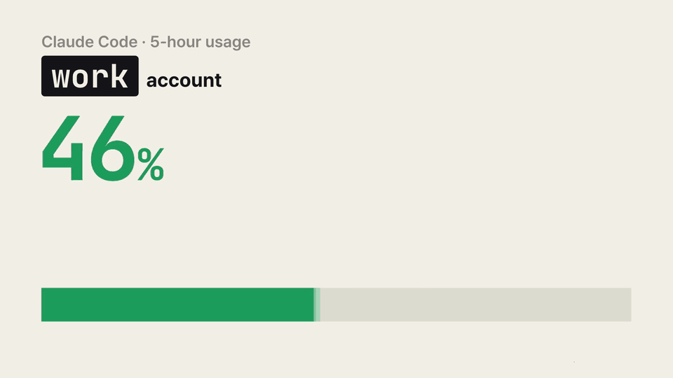

# ccm

**English** · [한국어](README.ko.md)

A command-line tool for people who use several Claude Code accounts: see how much usage each account has left on one screen, and switch to the one with the most headroom.

<p align="center">
  
</p>

<p align="center"><a href="docs/media/ccm-intro-en.mp4">Watch with sound (MP4, 15 s)</a></p>

ccm prints in English, or in Korean when your locale or macOS system language is Korean. See [Output language](#output-language) to change it.

## When you need it

- Claude Code stopped in the middle of your work because you hit a usage limit.
- You have several accounts, but the only way to find one with room left is to log in to each.
- Switching to another account means explaining your task from scratch again.

ccm takes care of all three.

1. **Usage per account, in one table.** The 5-hour and weekly usage of every account, and when each one resets.
2. **Switch without logging out.** Log in to each account once. Pick one in the table with the arrow keys and ccm starts `claude` with it.
3. **Keep the conversation.** Conversation history, settings and skills are shared across accounts. When you hit a limit, `ccm next -c` moves to the account with the most headroom and reopens your last conversation.

ccm never reads or copies your login tokens. Logging in is done by Claude Code's own `claude auth login`; ccm only points Claude Code at a separate config folder for each account.

## Install

### Requirements

| You need | Check with |
| --- | --- |
| macOS (tested) or Linux (not tested). Windows is not supported | |
| Python 3.8 or later | `python3 --version` |
| Claude Code, installed and logged in | `claude --version` |
| zsh or bash | `echo $SHELL` |

If you don't have Claude Code yet, follow the [official setup guide](https://docs.anthropic.com/en/docs/claude-code/setup) and log in once. ccm uses only the Python standard library, so there is nothing else to install.

### Step 1. Download

Put ccm in a folder where it can stay. If you move the folder later you'll have to reconnect it (see the FAQ), so pick the place first.

```sh
git clone https://github.com/revfactory/ccm.git ~/ccm
cd ~/ccm
```

### Step 2. Install the `ccm` command

```sh
./install.sh
```

This creates a link at `~/.local/bin/ccm`. If it warns that `~/.local/bin` is not on your PATH, add it to your shell config:

```sh
echo 'export PATH="$HOME/.local/bin:$PATH"' >> ~/.zshrc   # ~/.bashrc for bash
source ~/.zshrc
```

### Step 3. Connect the status line and the shell function

```sh
ccm setup
source ~/.zshrc   # source ~/.bashrc for bash, or open a new terminal
```

This sets up two things.

- **Status line**: the status line at the bottom of Claude Code records each account's usage. If you already had a status line it keeps showing, followed by something like `[work] 5h 72% ↻16:26 · 7d 31%`.
- **Shell function**: typing plain `claude` starts the account you picked in ccm.

Before changing `~/.claude/settings.json`, ccm saves a backup next to it (`settings.json.ccm-backup-<time>`). Run `ccm setup --undo` to revert.

### Step 4. Add your accounts

The account you have been using so far is already registered as `default`. Give each other account a name and add it:

```sh
ccm add work
ccm add side --email side@example.com   # pre-fill the email on the login page
```

A browser window opens; log in with the account you want under that name. When it finishes, ccm shows which email you logged in with.

- If your browser is already logged in to another account, that account may be approved as-is. Log out in the browser first, or open the login URL printed in the terminal in a private window.
- ccm warns you if the account is one you have already registered.
- MCP servers and trusted folders from the `default` account are copied to the new account, so Claude Code won't ask you to trust those folders again. Add `--no-sync` to skip this.

### Step 5. Run each account once

Usage is recorded by the status line while you use Claude Code. For each account you added, start it once, send one message, wait for the reply and exit.

```sh
ccm run work
```

On the first run Claude Code may ask you to pick a theme again.

### Step 6. Check

```sh
ccm doctor
```

If every line starts with `✓`, you are done. Lines that start with `!` explain what to fix; `ccm doctor --fix` repairs missing links.

## Usage

### Pick an account from the table: `ccm`

```text
$ ccm
Claude Code accounts · current: default · 15:27
      #  name     account             plan  5-hour                      weekly                      updated
   ●  1  default  me@gmail.com        Max   ████████ 100% LIMIT ↻16:57  █████░░░  64% ↻10/30 15:57  2m ago
      2  work     me@company.example  Max   ███░░░░░  38% ↻17:40        ███░░░░░  41% ↻10/29 15:27  3h ago
❯     3  side     side@example.org    Pro   █░░░░░░░  12% ↻18:47        █░░░░░░░   9% ↻10/31 15:27  1d ago
Usage is the last value each account's status line received; windows past their reset time show 0%.
Most headroom: 3 side (5h 12% · weekly 9%)
↑↓ move · Enter launch · Esc quit
```

| Key | Action |
| --- | --- |
| ↑ ↓ (or k j) | Move the cursor. ↓ on the last row wraps to the top |
| 1\~9 | Jump to that account number |
| Enter | Switch to the account under the cursor and start `claude` |
| Esc (or q) | Asks whether to quit. y or Enter quits; n or Esc goes back to the table |
| Ctrl+C | Quit immediately |

### When you hit a limit: `ccm next -c`

1. Exit the Claude Code session that hit the limit with `/exit`.
2. Run:

```sh
ccm next -c
```

ccm switches to the account with the most headroom (other than the current one) and reopens the last conversation in the same project. `-c` is passed to `claude` as is (continue the previous conversation). How the account is chosen is described under "How ccm picks the account with the most headroom" below.

Sessions that are already running keep their account. The new account applies to `claude` processes started after the switch.

### Common commands

| To do this | Run |
| --- | --- |
| Pick from the table and start `claude` | `ccm` |
| Pick from the table and continue the last conversation | `ccm -- -c` |
| Switch to the account with the most headroom and continue | `ccm next -c` |
| Switch only (applies to the next `claude`) | `ccm use work` or `ccm use 2`; from the table, `ccm -n` |
| Run another account once, keeping the current one | `ccm run side -c` |
| Show the table / as JSON | `ccm ls`, `ccm ls --json` |
| Add / re-login / remove an account | `ccm add work`, `ccm login work`, `ccm rm side` |
| Copy MCP servers and trusted folders from default to other accounts | `ccm sync` (preview: `ccm sync --dry-run`) |
| Check and repair the setup | `ccm doctor`, `ccm doctor --fix` |
| Show or set the output language | `ccm lang`, `ccm lang en` |

You can refer to an account by name, number, a name prefix, or part of its email.

### Output language

ccm picks its language in this order:

1. The `CCM_LANG` environment variable (`en` or `ko`)
2. The value saved with `ccm lang en` or `ccm lang ko`
3. Korean if `LC_ALL`, `LC_MESSAGES` or `LANG` starts with `ko`
4. Korean if the first macOS system language is Korean
5. Otherwise English

`ccm lang` shows the current language and why it was chosen. `ccm lang auto` removes the saved value.

## Reading the table

| On screen | Meaning |
| --- | --- |
| `account` / `plan` / `updated` | Account email / plan / when usage was last recorded |
| `5-hour` / `weekly` | Usage in the 5-hour window / the weekly window |
| `●` | The current account. The shell function starts `claude` with it |
| `❯` and the highlighted row | The cursor |
| Bar color | Green below 70%, yellow 70\~89%, red 90% and above |
| `LIMIT` | That window has reached 100% |
| `↻16:57` | When that window resets. A date is added if it is not today, e.g. `↻10/30 15:57` |
| `reset` | The reset time has passed; shown as 0% |
| `no data` | Claude Code hasn't been used with this account yet |
| `Most headroom: 3 side` | The other account with the most headroom, i.e. what `ccm next` would pick. Press its number to move the cursor there |

The values are what the status line received **the last time Claude Code was used with each account**. Usage on claude.ai or on other computers since then shows up the next time you use Claude Code with that account.

### How ccm picks the account with the most headroom

- For each account it looks at whichever window (5-hour or weekly) is closer to its limit, and picks the account where that value is lowest. Ties go to the lower 5-hour usage. Windows with no data count as 0%.
- Accounts that are not logged in, accounts authenticated another way (such as an API key), and accounts logged in with the same email as the current one are skipped.
- If every other account has hit a limit, ccm doesn't switch and tells you which account frees up first and when.

## FAQ

**The table shows `no data` everywhere.**
Usage is recorded only after you get a reply from Claude Code with that account (`ccm run <name>`). If it still stays empty, check the status line with `ccm doctor`.

**I get `ccm: command not found`, or Claude Code's status line is blank.**
Moving or renaming the ccm folder leaves `~/.local/bin/ccm` pointing at a file that no longer exists. Claude Code doesn't show an error in that case; it just leaves the status line blank, and usage stops being recorded. Run this in the new location:

```sh
./install.sh          # recreate the link to the new location
./ccm doctor --fix    # check and repair the link and the status line command
```

**I added an account but it logged in as a different one.**
Your browser approved the account it was already logged in to. Log out in the browser or use a private window, then run `ccm login <name>`.

**ccm warns that `ANTHROPIC_API_KEY` is still set.**
While that variable is set, Claude Code uses the API key instead of the account you logged in with. Remove it from your shell config, then open a new terminal or run `unset ANTHROPIC_API_KEY`. If you run `!ccm` inside a Claude Code session, the session's inherited value keeps triggering the warning, so check from a new terminal.

**Do I have to register my MCP servers again for each account?**
`ccm add` copies the default account's MCP servers. If you add servers to default later, run `ccm sync`. Project-scoped servers in a repository's `.mcp.json` work in every account without copying.

**Does it work with Team plans?**
Usage recording has been confirmed with a Team plan account. Enterprise accounts have not been tested.

**How do I uninstall ccm?**

```sh
ccm rm <name>          # for each account you added (also removes its login from the keychain)
ccm setup --undo       # restore the status line setting and remove the shell function
rm ~/.local/bin/ccm
rm -rf ~/.ccm
```

## How it works

- **A separate config folder per account.** ccm uses the multi-account approach from the Claude Code docs (`CLAUDE_CONFIG_DIR`). Your existing `~/.claude` is the `default` account; each added account uses `~/.ccm/profiles/<name>/`.
- **Claude Code handles login.** `ccm add` runs `claude auth login` with that folder. Claude Code stores the login in the keychain per folder.
- **The status line records usage.** Claude Code passes `rate_limits` (5-hour and weekly usage and reset times) to the status line command. ccm saves them to `~/.ccm/usage/<name>.json`.
- **Settings and history are shared.** Each added account's folder contains symlinks to the settings, skills, plugins, session history and task lists in `~/.claude`. That is why you can switch accounts in the same project and continue where you left off.

<details>
<summary><b>What carries over when you switch accounts</b></summary>

Sessions from every account are recorded under the same folders in `~/.claude`, so within the same project folder every account shares the following.

| To do this | Shared data |
| --- | --- |
| Continue the last conversation with another account (`claude -c`, `ccm next -c`) | Session history in `projects` |
| Reopen an earlier session (`/resume`, `claude --resume`) | Sessions from all accounts appear in one list |
| See the task list of a continued session | `tasks`, `todos`, `plans` |
| Remember the project in new sessions | Auto memory in `projects/<project>/memory`, `CLAUDE.md` |
| Recall earlier prompts with ↑ | `history.jsonl`, `paste-cache` |
| Undo file changes (`/rewind`) | `file-history` |
| Find and message sessions running under another account | `sessions`, `teams` |

Continuing the same session with `claude -c` from another account's folder has been verified with the real `claude`. To keep session history separate, add `--no-share-history` when adding the account.

</details>

<details>
<summary><b>What is shared and what is not</b></summary>

A new account folder gets these links to `~/.claude`:

- Settings: `settings.json`, `CLAUDE.md`, `agents`, `commands`, `skills`, `plugins`, `output-styles`, `hooks`, `memory`, `keybindings.json`, `loop.md` (only those that exist in `~/.claude`), `rules`, `workflows`, `themes`, `agent-memory`
- History: `projects`, `history.jsonl`, `file-history`, `todos`, `plans`, `tasks`, `teams`, `paste-cache`, `session-env`, `sessions`

The history folders and `rules`, `workflows`, `themes` and `agent-memory` are created in `~/.claude` first if they don't exist. Without the link, Claude Code would create the folder inside the account folder and the data would split by account. For example, subagents with user-scope memory write to `agent-memory`; without the link each account would have its own memory.

Every run of `ccm`, `ccm ls`, `ccm use`, `ccm run` and `ccm next` checks the links. Missing links are created. If a history folder has been created inside an account folder, its contents are moved to `~/.claude` and the folder is replaced with a link. Folders with the same name are merged; files with the same name are moved with the account name appended (e.g. `note.json.work`), and nothing is deleted (except `.DS_Store`). What was moved is reported in one line.

Kept separate per account:

- **Login**: the whole point of separate accounts.
- **`.claude.json`**: user- and local-scope MCP servers, folder trust and first-run settings. It also holds the logged-in account, so it can't be shared by a link. `ccm sync` copies the MCP servers and folder trust instead.
- **`jobs`, `daemon`**: background jobs that run per account. Sharing them could run the same job twice.

If Claude Code replaces a link with a regular file when saving settings, that item is no longer shared. `ccm doctor` finds such items.

</details>

<details>
<summary><b>Copying MCP servers and folder trust (<code>ccm sync</code>)</b></summary>

`ccm sync` reads these settings from one account's `.claude.json` and merges them into other accounts' `.claude.json`. The default account's file is `~/.claude.json`; added accounts use `~/.ccm/profiles/<name>/.claude.json`.

- User-scope MCP servers (added with `claude mcp add -s user`)
- Local-scope MCP servers per project (added with `claude mcp add` in that folder)
- Folder trust (folders you allowed in the trust prompt)

| To do this | Run |
| --- | --- |
| Copy default's settings to all other accounts | `ccm sync` |
| Copy to specific accounts only | `ccm sync work side` |
| Copy from another account | `ccm sync --from work` |
| Preview the changes | `ccm sync --dry-run` |
| Also overwrite MCP servers with the same name but different settings | `ccm sync --replace` |

Only missing entries are added; nothing is removed. MCP servers with the same name but different settings are left alone and listed. ccm takes the same lock Claude Code uses for this file (the `.claude.json.lock` folder), so it doesn't overwrite changes from sessions running under that account. Running sessions pick up the changes after a restart.

</details>

<details>
<summary><b>Details of usage recording</b></summary>

- With several sessions on the same account, idle sessions also redraw their status line when the prompt cache expires or a window resets, using the last values they received. ccm ignores those older values: within the same reset time it keeps only higher usage, and values from windows that have already ended are dropped.
- Profiles logged in with the same email and organization share their limits, so the table shows the most recent record among them.
- Environment variables are fixed when a process starts. Removing one from your shell config doesn't affect terminals or Claude Code sessions that are already open.
- `ccm` and `ccm doctor` check that the Python and ccm file named in the status line command actually exist, and warn if not.

</details>

## Files

| Path | Contents |
| --- | --- |
| `~/.ccm/config.json` | Accounts, current account, last checked email and plan |
| `~/.ccm/current-dir` | Current account folder read by the shell function (empty for default) |
| `~/.ccm/profiles/<name>/` | Claude Code config folder of an added account |
| `~/.ccm/usage/<name>.json` | Usage recorded by the status line, per account |
| `~/.ccm/statusline-prev.json` | Your status line setting before `ccm setup` (restored by `--undo`) |

## Tests

```sh
python3 -m unittest tests.test_ccm -v
```

The tests use a fake `claude` (`tests/fake_claude.py`) and temporary folders under `_workspace/tmp/`; they never touch your real keychain or `~/.claude`.

## License

[MIT](LICENSE)
